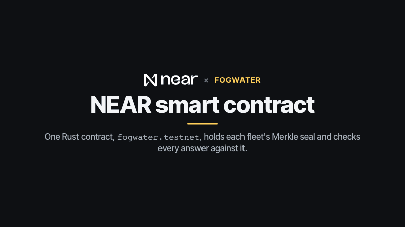
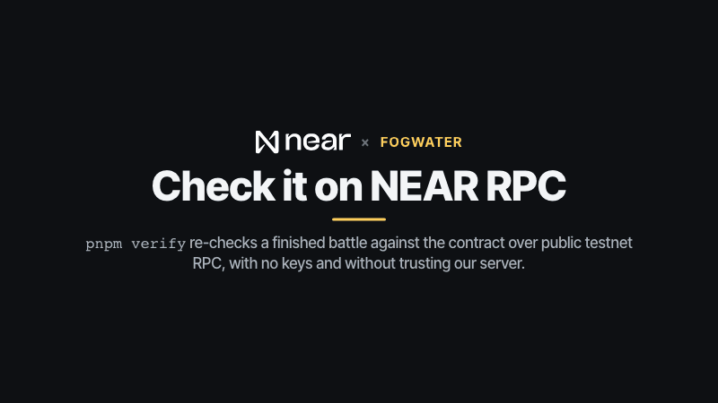
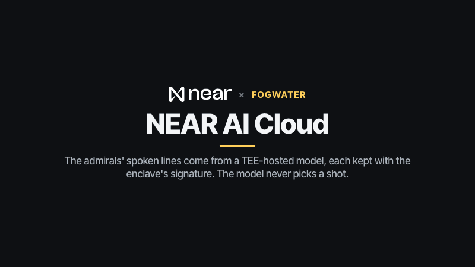
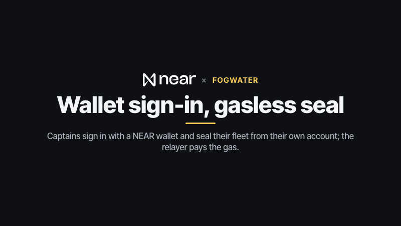
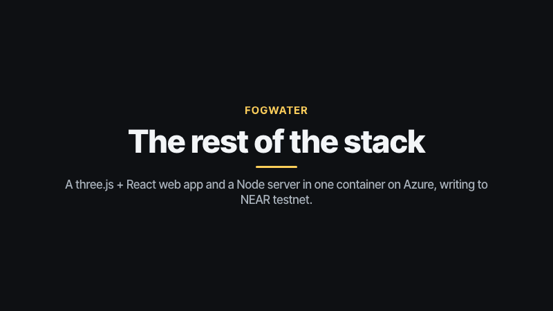

# Fogwater

> Part of the **NEAR Arcade** submission for NEAR HACKATHON (https://arcade.lopeselio.online, [github.com/lopeselio/near-arcade](https://github.com/lopeselio/near-arcade)); the author's other submission is **Signalfire** ([github.com/lopeselio/signalfire](https://github.com/lopeselio/signalfire)).

A night sea battle on NEAR, in voxels. Place your fleet, seal it, and trade cannon fire with an AI admiral or a friend. Your fleet is **sealed onchain as a Merkle root** before the first shot, every "hit" or "miss" is **proven against that seal by the contract**, and both fleets are **revealed and checked** when the last ship sinks. Nobody sees your ships until then: not your rival, not the AI, not our server.

Built for NEAR HACKATHON (Nov 2026). In the NEAR Arcade, Fogwater is claimed for the tracks **Games With Real Economies** (games) and **Privacy & Private AI** (privacy). Design: [DESIGN.md](DESIGN.md).

- Contract (testnet): [`fogwater.testnet`](https://testnet.nearblocks.io/address/fogwater.testnet). Referee: [`fogwater-ref.testnet`](https://testnet.nearblocks.io/address/fogwater-ref.testnet). Gasless relayer: [`fogwater-relay.testnet`](https://testnet.nearblocks.io/address/fogwater-relay.testnet) (pays for signed-in captains' `seal` meta-transactions).
- Hosted: https://fogwater.lopeselio.online/, also inside the NEAR Arcade at https://arcade.lopeselio.online/fogwater.

## Try it (do X, see Y)

Every step below works on the hosted game, https://fogwater.lopeselio.online/. To run it yourself:

```bash
pnpm install
pnpm build            # the web app
pnpm start            # http://localhost:8787 (server + built web app)
```

With no NEAR keys, run `CHAIN=0 pnpm start`: everything plays the same, but nothing is written onchain.

0. **First visit.** Four welcome cards explain the game (Skip or Next). In your first battle a step-by-step walkthrough waits for you to do each thing: move a ship, seal, fire. **? How to play** (or the `?` key) opens the rules, controls and how fairness works, and can replay the tour.
1. **Battle an admiral.** Type a name, pick **Captain Marrow**. You see your waters (left) with a random fleet, and enemy waters (right) under fog; on a phone they are two tabs, **Your waters** and **Enemy waters**, under the status bar. The admiral greets you; with a NEAR AI key the line is marked "✓ signed by NEAR AI TEE".
2. **Place and seal.** Click a ship to pick it up, click a cell for its bow, **R** (or right-click) to turn it, or **Shuffle** (on a phone: tap a ship, tap where its bow goes, **Turn** rotates it). Press **Seal fleet**. The side panel shows "Your seal: <root>…" and an onchain `seal` transaction.
3. **Fire.** Click a cell in the fog. A cannonball arcs over, the fog clears, and you see a splash (miss) or fire (hit). The admiral fires back; your browser answers its shot by itself (it holds your fleet), and the answer is checked against your seal. Sinking a ship shows "You sank their Frigate!".
4. **Win or lose.** At 17 hits both fleets are revealed: the fog lifts and the admiral's ships appear. The end panel names the winner, shows both captains' shots and accuracy (yours under "You"), and says the contract rebuilt both seas and found them legal. **Proof (JSON)** opens the full move log with every opening.
5. **Check it yourself**, with no keys and without trusting our server. The end panel prints the command for your own game; this one is a hosted game played by `pnpm e2e` on 12 Nov 2026 (output pasted as run that day):

   ```
   pnpm install
   pnpm verify 066a93d24a39 https://fogwater.lopeselio.online
   ✓ both fleet roots match the contract (fogwater.testnet)
   ✓ all 102 answers open the sealed roots (Merkle proofs checked)
   ✓ the replayed shots match the contract’s record
   ✓ seat 1's revealed fleet is legal, matches its root and every “sunk” report
   ✓ seat 2's revealed fleet is legal, matches its root and every “sunk” report
   ✓ winner: seat 2 (fleet sunk); hits 10/17 vs 17/17
   ```

   The host argument defaults to https://fogwater.lopeselio.online. The contract is read through public testnet RPCs (drpc, then intea, then fastnear), retrying with backoff if one rate-limits. `524ed845912f` is another hosted game that passes.
6. **Challenge a friend.** **Create a challenge link**, place and seal your fleet, and send the link (Copy / Share). Your friend opens it, takes the second seat, seals theirs, and you play: live if you're both there, or one move at a time (3 days per move). The tab title shows "● Your move". **Your battles** on the harbour lists every game this browser plays.
7. **Sign in with NEAR** (top right; NEAR Connect: Meteor, Intear, HOT, MyNearWallet, …). The wallet signs "Sign in to <host>" (NEP-413); Better Auth + better-near-auth start a session. Signed-in captains seal their fleet **from their own wallet**, gasless (a NEP-366 meta-transaction paid by `fogwater-relay.testnet`), and are ranked in the **Admirals' ledger** (`leaderboard` on the contract).
8. **Headless:** `pnpm --filter @fogwater/server e2e https://fogwater.lopeselio.online widow` (or `http://localhost:8787`) plays a full game as a browser would and prints every transaction. The run behind the example above:

   ```
   game 066a93d24a39 vs widow
   phase done, winner seat 1 (fleet sunk); shots 51 vs 51
     create_game            https://testnet.nearblocks.io/txns/MmQGYNL8e6A5TxxT3BekR4VpJU4Dy4BMxian1mfBi1b
     seal (admiral)         https://testnet.nearblocks.io/txns/AaLR9TL2oeDwnSw5gnhyKLHiTM51DXwCM13cBJpvDDws
     seal (E2E)             https://testnet.nearblocks.io/txns/EgTuZDkYao96Rpp3FQsdHqgPjnReeUaYaXBVYxNNokjW
     play ×12               https://testnet.nearblocks.io/txns/CpVdw2vJpwTMSyYVM3EQhZ9qka9BYiLFKqne1CDdnPYm
     … 7 more play ×12 batches …
     play ×12               https://testnet.nearblocks.io/txns/2G3Q5dcr9sDo4nDiQko5CaR9fcySXS7wZXD7HowzG19N
   check it: pnpm verify 066a93d24a39 https://fogwater.lopeselio.online
   ```

   (The e2e counts seats from 0, verify from 1: both name The Grey Widow. The two `reveal` transactions follow; the game's **Proof (JSON)** at https://fogwater.lopeselio.online/api/games/066a93d24a39/proof lists all of them.)

### A signed-in game (wallet sign-in, relayed seal, the Admirals' ledger)

> **Placeholder, to be filled after the author's signed-in wallet test.** Until then this section has no evidence: guest games are sealed by the referee, and the contract's `leaderboard` was `[]` on 12 Nov 2026.

- Game: `<game id>`, played signed in as `<account>.testnet` (hosted).
- Relayed `seal` from the captain's own key, paid by `fogwater-relay.testnet`: `https://testnet.nearblocks.io/txns/<hash>`. The signer is the captain's account, the receiver is `fogwater.testnet`, and it went through the relayer as a NEP-366 delegate action.
- `pnpm verify <game id> https://fogwater.lopeselio.online`: `<paste output>`.
- The Admirals' ledger after that game: `curl -s https://fogwater.lopeselio.online/api/leaderboard` or `near contract call-function as-read-only fogwater.testnet leaderboard json-args '{"limit":20}' network-config testnet now`: `<paste output>`.


## How it works

```
apps/web          three.js voxel sea + React HUD (Vite); NEAR Connect wallet; guests need no wallet
apps/server       games, the admirals, the chain queue (batched `play` calls), WebSocket push, Better Auth, verify + e2e CLIs
packages/rules    board, Merkle seals and openings, turn rules, reveal checks, the admirals' planners (deterministic, isomorphic)
contracts/fleet   Rust near-sdk 5.29: games, seals, answers checked against roots, reveals, timeouts, ledger
```

- **Sealed fleets (privacy).** Every cell of your sea becomes `sha256("fogwater|leaf|<game>|<cell>|<0/1>|<salt>")` with a per-cell salt from your secret seed; the 100 leaves form a Merkle tree and only the root goes onchain. Answering a shot opens one leaf with 7 sibling hashes; the contract refuses any answer that doesn't hash to your root. At the end the contract rebuilds both trees from the revealed seeds: an illegal fleet, a moved ship or a false "sunk" call loses. An all-water sea is caught on the 84th miss.
- **The AI can't cheat.** The admiral's fleet is sealed before your first shot, and it never sees yours: the server only ever receives openings for cells that were shot. Its planner uses its own hits and misses only. The model on NEAR AI only talks; each line is kept with its request, response and the enclave's signature.
- **Chain invisible.** Guests never touch a wallet. The referee batches shots and answers into `play` calls (up to 12 moves each, ~28 transactions and ~0.01 NEAR per game). Signed-in captains approve one gasless transaction per game: sealing their fleet.

### What the chain does *not* prove

- The referee relays everyone's shots, so it could fire a captain's shot at a cell they didn't choose (it can't forge an answer).
- Guest seats are labels the server speaks for; only signed-in captains seal from their own key.
- Your fleet secret lives in this browser's storage. Open a game on another device and it can't answer shots there.

## Built on NEAR

What each NEAR technology does in Fogwater, and where to look. Each GIF is a short loop (12 seconds or less).

| Technology | What Fogwater uses it for | Where to look |
|---|---|---|
| NEAR smart contract (Rust, near-sdk 5.29.1) | games, sealed fleet roots, every shot and answer checked against its root, reveals, timeouts, the Admirals' ledger | [`contracts/fleet`](contracts/fleet/src/lib.rs), [`fogwater.testnet`](https://testnet.nearblocks.io/address/fogwater.testnet) |
| NEAR RPC (public testnet endpoints) | `pnpm verify` reads the game from the contract with no keys and re-checks the server's proof bundle against it | [`apps/server/src/verify.ts`](apps/server/src/verify.ts) |
| NEAR AI Cloud | the admirals' spoken lines from a TEE-hosted model, each kept with the enclave's signature; `/api/attestation` serves the TEE report | [`apps/server/src/nearai.ts`](apps/server/src/nearai.ts), [`apps/server/src/games.ts`](apps/server/src/games.ts) |
| NEP-413 sign-in, NEP-366 meta-transactions | wallet sign-in (Better Auth + better-near-auth, NEAR Connect); signed-in captains seal their fleet from their own account, gas paid by `fogwater-relay.testnet` | [`apps/web/src/wallet.ts`](apps/web/src/wallet.ts), [`apps/server/src/ba.ts`](apps/server/src/ba.ts) |

### NEAR smart contract: sealed fleets, proven answers



One Rust contract, [`fogwater.testnet`](https://testnet.nearblocks.io/address/fogwater.testnet), holds the battle.
`commit_fleet` stores only a 32-byte Merkle root of your salted sea; each `Answer` in a `play` call opens one cell with
7 sibling hashes, and `verify_opening` refuses any answer that doesn't hash to that root
([`lib.rs`](contracts/fleet/src/lib.rs), same bytes as [`commit.ts`](packages/rules/src/commit.ts)). After 17 hits
`reveal_fleet` rebuilds the whole tree from the seed: an illegal fleet, a moved ship or a false "sunk" loses, and anyone
may call `claim_timeout` on a seat that stops answering.

### NEAR RPC: check a battle yourself



[`verify.ts`](apps/server/src/verify.ts) downloads the game's proof bundle and reads `get_game` from the contract through
public testnet RPCs (drpc, intea, fastnear), with no keys. It opens every answer against the sealed roots, replays the
turns with `packages/rules`, checks both revealed fleets and compares everything with the contract's record. The last
beat is the real output for hosted game `066a93d24a39` (step 5 above).

### NEAR AI Cloud: admirals that talk, not aim



The admirals aim with [`admiral.ts`](packages/rules/src/admiral.ts), seeded and from their own hits and misses only. Their
lines come from `Qwen/Qwen3.6-35B-A3B-FP8` on NEAR AI Cloud ([`nearai.ts`](apps/server/src/nearai.ts)): each reply is
stored in the proof bundle with its exact request, response and the enclave's ECDSA signature, and shows
"✓ signed by NEAR AI TEE" in game. `/api/attestation` returns the model's TEE report bound to a fresh 32-byte nonce.

### NEP-413 sign-in and NEP-366: your seal, from your wallet



Sign-in is Better Auth with better-near-auth ([`ba.ts`](apps/server/src/ba.ts)): the wallet signs "Sign in to &lt;host&gt;"
and the server checks it against a full-access key. A signed-in captain's `commit_fleet` is a NEP-366 delegate action
signed in their wallet ([`wallet.ts`](apps/web/src/wallet.ts)) and relayed by `fogwater-relay.testnet`, which only relays
to Fogwater and never attaches a deposit; the contract requires that seal to come from the seat's own account. Their
results go to `stats_of` and `leaderboard`.

### The rest of the stack



The web app is a three.js voxel scene with a React HUD ([`apps/web`](apps/web/src)); the Node server
([`apps/server`](apps/server/src)) runs games and admirals and batches moves into `play` calls with near-api-js and
near-kit. [`packages/rules`](packages/rules/src) runs in both and is pinned to the contract by a shared hash test vector.
One container on Azure Container Apps ([`deploy-azure.sh`](scripts/deploy-azure.sh)) serves both, with an Azure Files share at `/data`.

## Tests

```bash
pnpm --filter @fogwater/rules test   # boards, seals/openings, turns, reveals, cheats, admirals
pnpm contract:test                   # 11 contract tests incl. the shared hash vector, lies, moved fleets, empty seas, timeouts
pnpm sim 300                         # admirals' shots-to-win
```

## Deploying

- **Contract:** `pnpm contract:build`, then `near contract deploy fogwater.testnet use-file contracts/fleet/target/near/fogwater_fleet.wasm with-init-call new json-args '{"owner":"fogwater.testnet","referee":"fogwater-ref.testnet"}' …` (later: `without-init-call`).
- **Hosting:** `scripts/deploy-azure.sh` (Azure Container Apps, one replica). `scripts/azure-storage.sh` mounts an Azure Files share at `/data` once, so games survive redeploys.

## Lineage and disclosures

- **Genre.** The grid sea battle is a public-domain classic. The look (a moonlit voxel world, fog of war) and the idea of hidden information enforced by cryptography were inspired by two hackathon games we admired: [Nightfall](https://github.com/codeswithroh/nightfall) and [Who Rug Us?](https://github.com/AiltonSavio/who-rug-us-monorepo), both on Solana/MagicBlock. Fogwater shares no code or assets with them; its privacy comes from Merkle commitments checked by a NEAR contract.
- **The NEAR Arcade.** Fogwater is one of the nine games in the author's NEAR Arcade submission (https://arcade.lopeselio.online, [github.com/lopeselio/near-arcade](https://github.com/lopeselio/near-arcade)). It has its own repo, contract, rules and server, and shares the arcade's sign-in pattern (Better Auth + better-near-auth). The author's other hackathon submission is [Signalfire](https://github.com/lopeselio/signalfire).
- **Libraries:** three.js, React, better-auth and better-near-auth, near-api-js, near-kit, @noble/hashes, ws, Vite, near-sdk (Rust).
- **Assets:** every model is procedural boxes in `apps/web/src/scene.ts`; sounds are synthesised in WebAudio; fonts are Inter and Silkscreen (Google Fonts, OFL).

## License

MIT
